# AI Health Analytics

**DeltaAI Health: an educational healthcare platform that combines machine learning, generative AI and full-stack web development.**

A patient selects their symptoms. A trained classifier estimates which of 41 conditions the pattern most resembles. A clustering model places the patient in a group of people with similar symptom patterns. A large language model then explains both results in plain language. Around that analysis sits a working doctor–patient platform with accounts, appointment booking, clinical notes and simulated prescriptions, all stored in MongoDB.

> **Educational project, not a medical device.** The predictions come from a model trained on a small symptom dataset. They are not diagnoses, the app has not been clinically validated, and it must not be used for medical decisions. Prescriptions in the app are simulations and are not legally valid. See [Responsible AI and limitations](#responsible-ai-and-limitations).

## Contents

1. [Project overview](#project-overview)
2. [Application preview](#application-preview)
3. [Key features](#key-features)
4. [System architecture](#system-architecture)
5. [Machine learning methodology](#machine-learning-methodology)
6. [Technology stack](#technology-stack)
7. [Software engineering and system design](#software-engineering-and-system-design)
8. [Technical challenges and learning outcomes](#technical-challenges-and-learning-outcomes)
9. [Responsible AI and limitations](#responsible-ai-and-limitations)
10. [Installation and local setup](#installation-and-local-setup)
11. [Project structure](#project-structure)
12. [Future improvements](#future-improvements)
13. [About the developer](#about-the-developer)

---

## Project overview

**The question behind the project:** what does it take to turn a machine learning model from a notebook experiment into something a patient and a doctor could actually use, and how do you do that responsibly?

Healthcare is a good place to explore this because the stakes make every design decision visible. A model's output has to be explained, not just displayed. Uncertainty matters as much as the answer. A doctor needs a different view from a patient. Features like appointment booking turn into real engineering problems, such as stopping two people from reserving the same time slot.

The project has three layers that depend on each other:

| Layer | What it does | Where it lives |
|---|---|---|
| **Machine learning** | Supervised classification of symptoms into conditions, and unsupervised clustering of symptom patterns | `prediction/`, `models/`, training notebook |
| **Generative AI** | An assistant that explains the ML results, grounded in the structured output of the models | `assistant/` |
| **Software platform** | Accounts, roles, doctor–patient relationships, appointments, notes and prescriptions, stored in MongoDB | `app.py`, `app_pages/`, `ui/` |

**Intended users** are two roles: **patients**, who run health analyses, connect with a doctor, book appointments and view prescriptions; and **doctors**, who review their patients' analyses, write notes, manage availability and appointments, and issue simulated prescriptions.

---

## Application preview

All screenshots use fictional demonstration accounts and data. Capture instructions and naming rules are in [docs/screenshots/README.md](docs/screenshots/README.md).

### Patient experience

**Sign in.** Patients and doctors share one sign-in screen; the role on the account decides which pages they get.

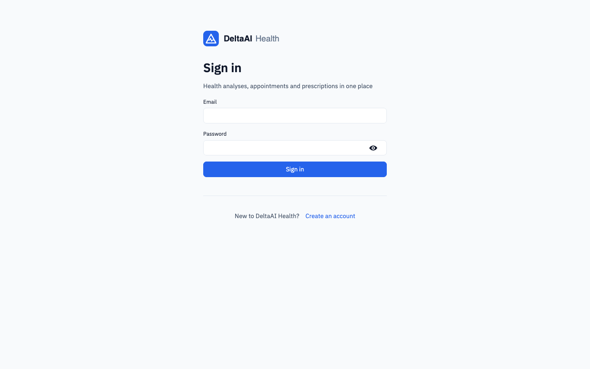

**Home.** The next appointment, the latest analysis and the connected doctor, with links into each area.

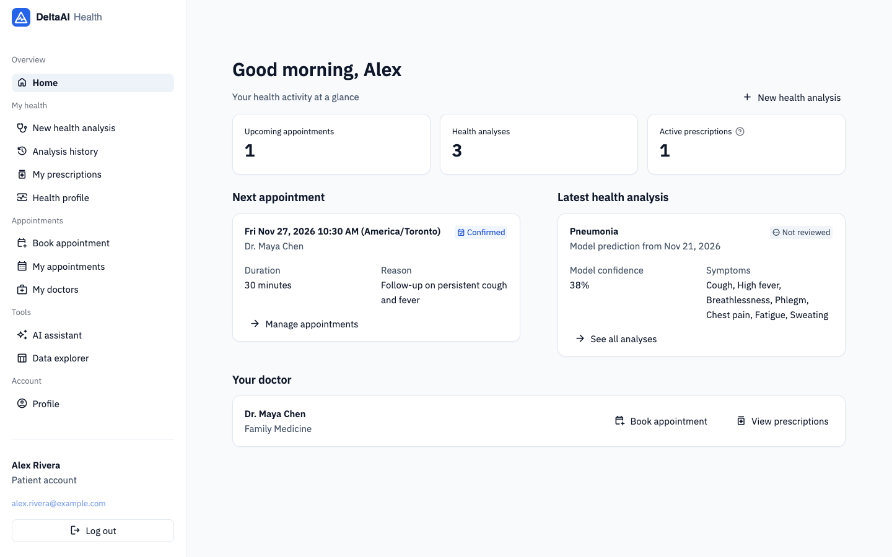

**Step 1: symptom selection.** A searchable list of the 132 symptoms the model was trained on.

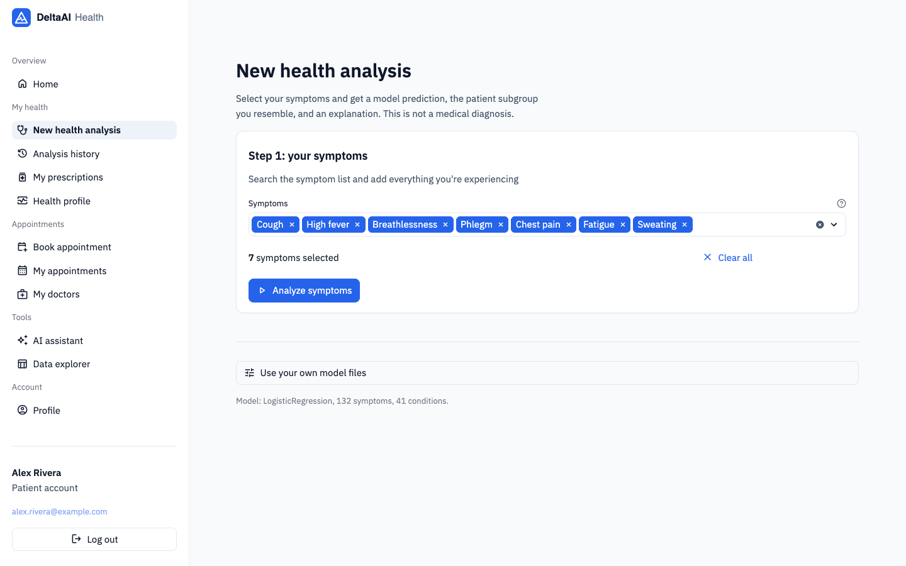

**Step 2: model output.** The classifier's top prediction, the next two alternatives, and a low-confidence warning because no condition reached 50%.

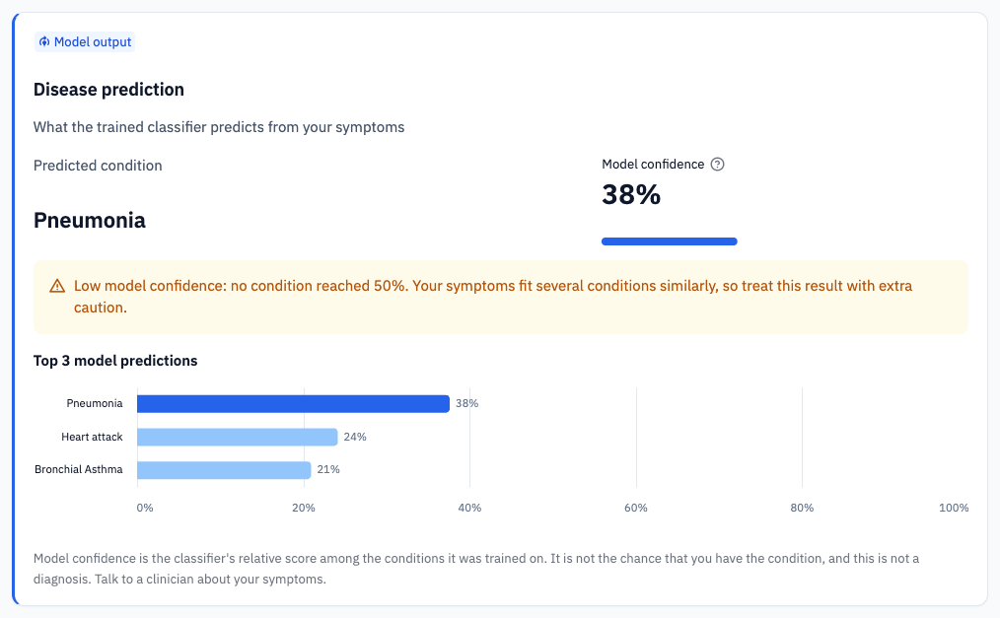

**Step 2: subgroup analysis.** The nearest K-Means cluster, with its most common symptoms and conditions, presented as a similarity grouping rather than a diagnosis.

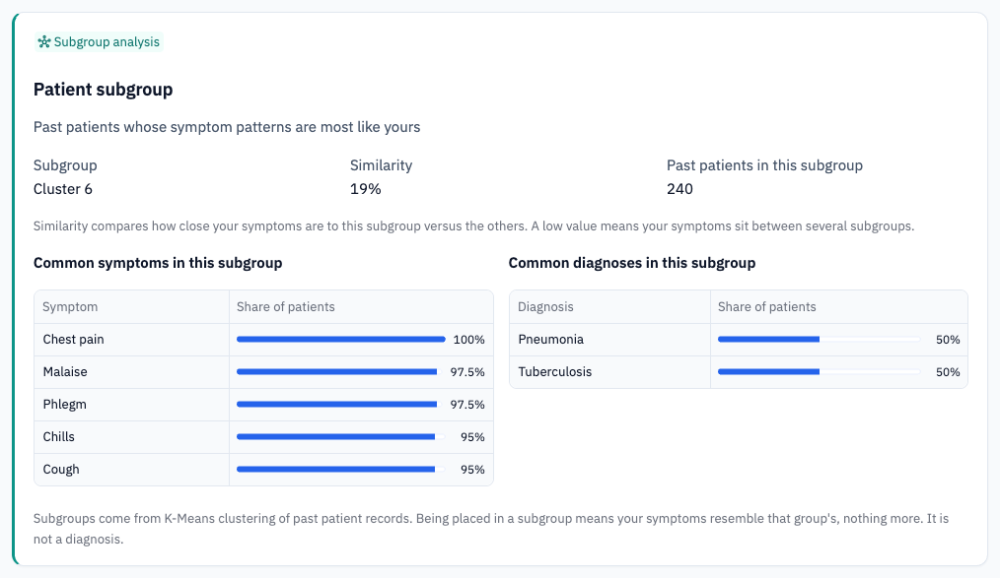

**Step 2: AI explanation.** A real answer from the Groq-hosted LLM, generated only from the model and cluster results above.

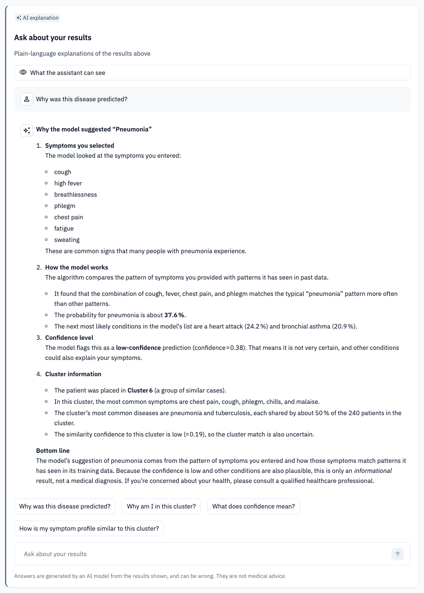

**Appointment booking.** Free slots generated from the doctor's working hours, shown in the doctor's time zone.

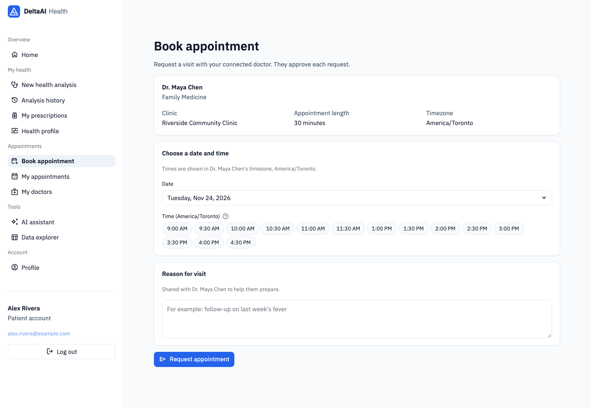

**Simulated prescriptions.** Finalized prescriptions with a PDF download, clearly marked as not legally valid.

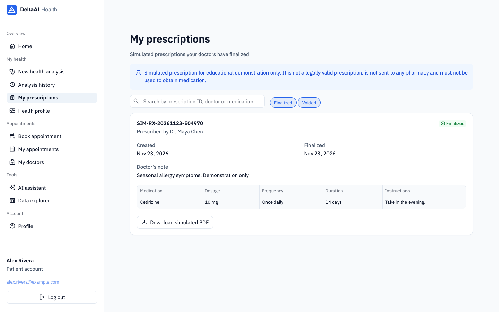

### Doctor experience

**Dashboard.** Upcoming visits, plus everything waiting for the doctor: appointment requests, a new patient request and unreviewed analyses.

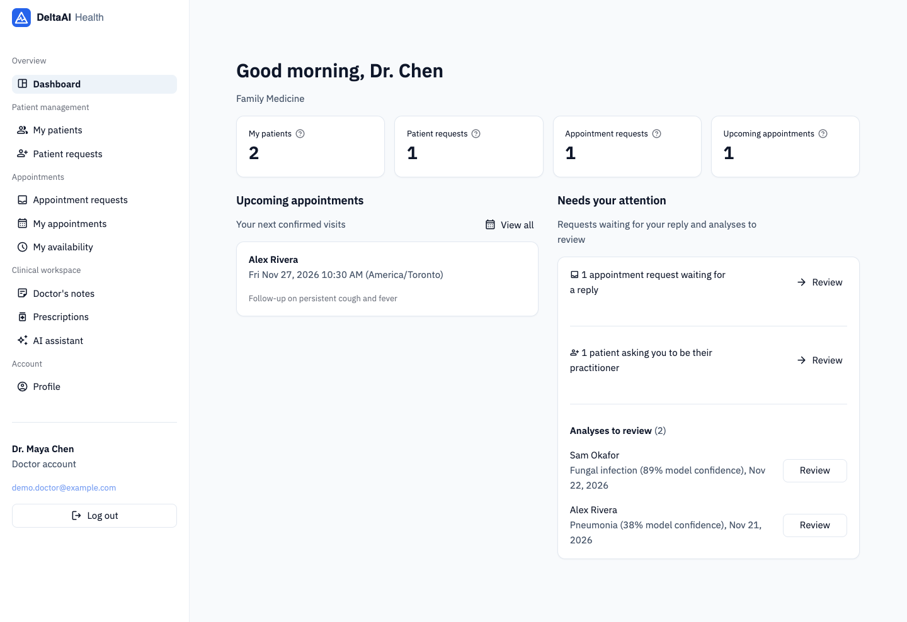

**Patient overview.** Profile, known conditions and full analysis history, with review status for each analysis.

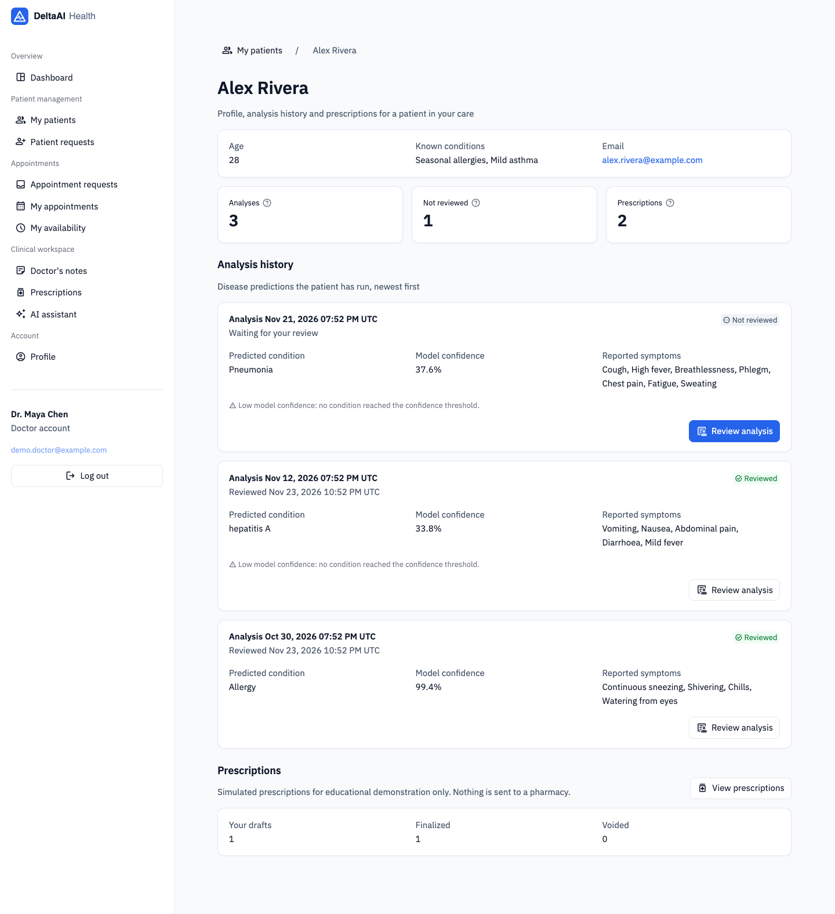

**Analysis review.** The same three labelled sources the patient sees, a doctor-specific AI assistant, and the doctor's notes for this analysis.

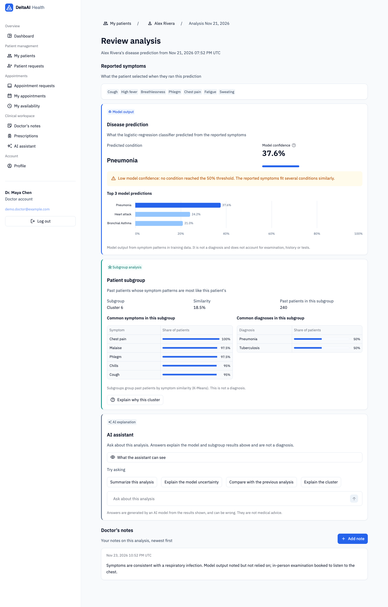

**Appointment requests.** A pending request holds its slot until it expires; the doctor can accept, reject or propose another time.

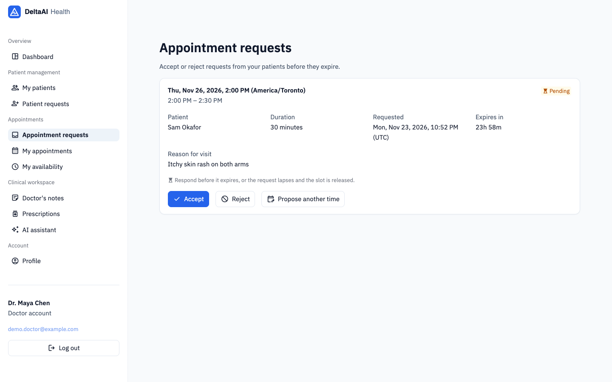

**Availability.** Weekly hours with split shifts, appointment length, breaks and blocked dates, with a preview of bookable times.

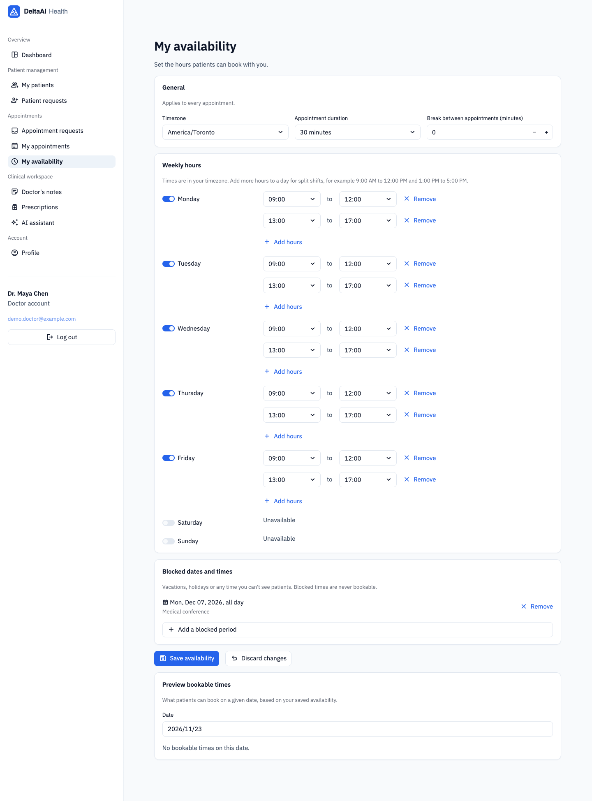

**Prescription detail.** A finalized simulated prescription with its audit history.

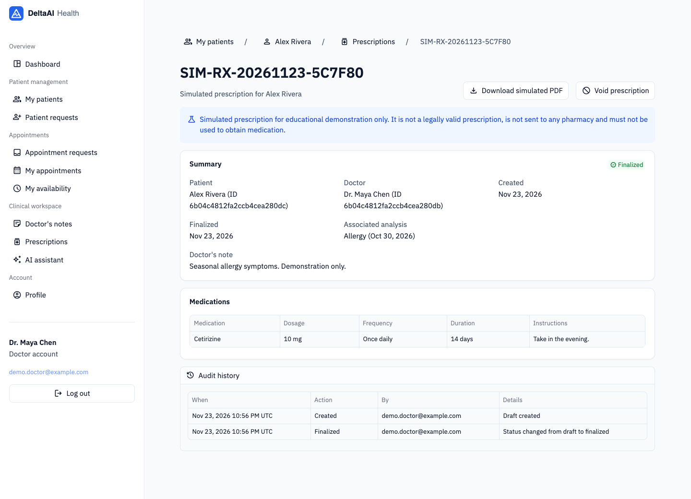

---

## Key features

### A. Machine learning

**Disease prediction (supervised learning).** The patient searches a list of 132 symptoms and selects the ones they have. The app turns the selection into a binary feature vector (1 = present, 0 = absent) in the exact column order the model was trained on. A logistic regression classifier then produces a probability for each of the 41 conditions it knows.

The results page shows:
- the top prediction and its model confidence
- the next two alternatives, in a chart
- a low-confidence warning when the top score is below 50%

This demonstrates feature encoding, multi-class classification, and the difference between a prediction and a probability distribution.

**Patient subgroups (unsupervised learning).** The same symptom vector goes to a K-Means model, which assigns the patient to the nearest of eight clusters learned from the training data. For that cluster, the app shows:
- the symptoms most common in it
- the conditions that appear in it
- a similarity score for every cluster
- why this cluster was chosen over the next-closest one

Patients and doctors can also browse and compare all eight clusters. The interface labels the cluster as a *similarity grouping*, not a diagnosis.

### B. Generative AI assistant

Patients (and doctors, on the analysis review page) can ask questions such as "Why was this disease predicted?" or "Why am I in this cluster?". The assistant:

1. **Packages the analysis as structured JSON:** selected symptoms, top predictions with probabilities, the cluster assignment and its top symptoms. For doctors it also includes the patient's known conditions and earlier analyses.
2. **Builds a prompt** that tells the model to explain *only* those values, not to invent diseases or numbers, and to say when information is missing.
3. **Calls the Groq API** (default model `openai/gpt-oss-20b`, temperature 0.2), sending the last few turns of conversation for context.

Two safety layers run before any API call. First, the assistant refuses if no analysis exists yet. Second, a rule-based `SafetyGuard` blocks requests for a diagnosis outside the model ("do I have…", "should I take…", "prescribe…") and off-topic questions. The interface keeps the three sources visually separate, labelling each section as **Model output** (classifier), **Subgroup analysis** (K-Means) or **AI explanation** (LLM). The point is that a fluent explanation should never be mistaken for the prediction itself.

### C. Patient features

| Feature | What the patient can do |
|---|---|
| Registration and sign-in | Create a patient account. Passwords are hashed with bcrypt. |
| Home | See the next appointment, latest analysis, active prescriptions and connected doctor. |
| New health analysis | Select symptoms, run both models in one step, and ask the AI assistant about the result. |
| Analysis history | Search and filter past analyses, and see whether a doctor has reviewed each one. |
| Health profile | Keep a list of known conditions that the doctor and doctor-facing assistant can see. |
| My doctors | Request a primary health practitioner, or ask to change doctors. |
| Appointments | Book a slot from the doctor's real availability, then cancel, reschedule or accept a reschedule. |
| My prescriptions | View finalized and voided simulated prescriptions, and download them as PDF. |
| Data explorer | Upload a CSV and explore it with count plots, scatter plots and a correlation matrix. |

### D. Doctor features

| Feature | What the doctor can do |
|---|---|
| Dashboard | See pending patient requests, appointment requests and analyses waiting for review. |
| Patient management | Accept or decline patients, view each patient's profile and full analysis history. |
| Analysis review | See every model output for one analysis, an explanation of the cluster assignment, and a doctor-specific AI assistant. Opening an analysis for review marks it as reviewed. |
| Doctor's notes | Write notes attached to a specific analysis, stored separately from the analysis itself. |
| Availability | Set weekly working hours, slot length, breaks between appointments, and blocked periods such as holidays. |
| Appointments | Accept or reject requests, propose new times, and record a visit as completed or a no-show. |
| Simulated prescriptions | Draft, edit, finalize or void prescriptions, with a full audit history and a PDF export. |

Only a patient's **current primary practitioner** can open their records, create prescriptions or receive their appointment requests. This rule is enforced in the service layer, not just hidden in the interface.

### E. Appointment management

An appointment moves through a small state machine:

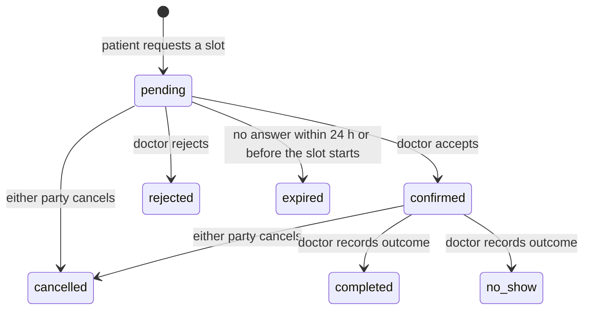

The interesting parts are not the calendar itself but the rules around it:

- **Slots come from the doctor's availability.** Weekly hours, slot length, break time and blocked periods are combined to generate bookable slots. Each slot is shown in the doctor's time zone, while times are stored in UTC.
- **A pending request holds its slot.** While it waits for an answer, nobody else can book that time. It expires after 24 hours or when the slot starts, whichever comes first.
- **Rescheduling is a proposal.** Either party can propose a new time, but the original appointment stays unchanged until the other party accepts.
- **Every change is recorded** in the appointment's history: who did what, and when.
- **Double booking is prevented** in two steps, explained [below](#preventing-double-booking).

---

## System architecture

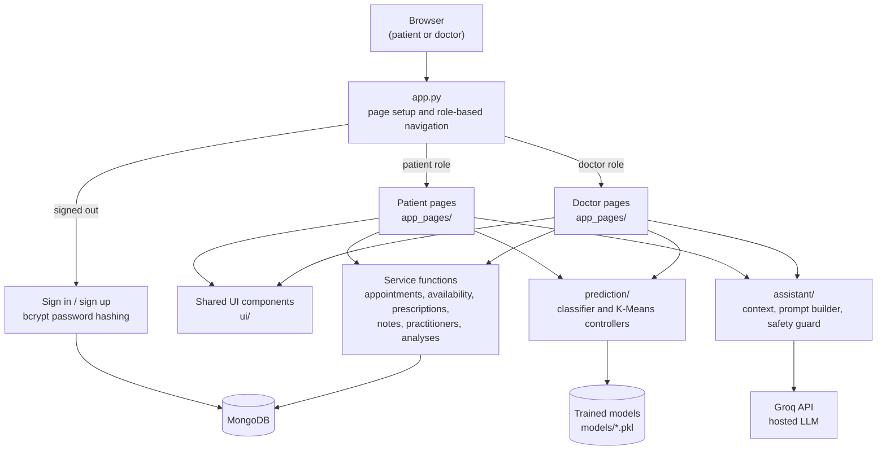

| Layer | Responsibility |
|---|---|
| **`app.py`** | Configures the page and theme, then decides which pages exist for the current user. A signed-out visitor only gets the sign-in screen. A patient never has doctor pages registered, and a doctor never has patient pages. |
| **Pages (`app_pages/*_page.py`)** | Streamlit UI only: read input, call a service, display the result. |
| **Services (`app_pages/*_service.py`)** | Business rules and database access, written as plain functions that receive MongoDB collections as arguments. This is what makes them unit-testable without a database. |
| **`prediction/`** | Loads the saved models, converts symptoms into feature vectors, and returns typed result objects (`PredictionResult`, `ClusterAssignmentResult`). |
| **`assistant/`** | Builds the LLM context and prompt, applies the safety guard, calls Groq, and keeps the conversation history. |
| **`ui/`** | Shared components (cards, status badges, confirmation dialogs, empty states) and the visual theme. |
| **MongoDB** | Stores users, practitioner requests, analyses, doctor notes, prescriptions, availability and appointments, one collection each. |

**How one analysis flows through the system:**
1. A patient selects symptoms on the analysis page.
2. `prediction/` encodes them and runs both models.
3. The page shows the results, and the analysis is saved to MongoDB.
4. When the patient asks a question, `assistant/` turns the saved results into JSON context for the LLM.
5. Later, the patient's doctor opens the same analysis from MongoDB and sees the same results, plus the doctor's own notes.

---

## Machine learning methodology

The models were developed in the notebook [`1784094414778_Disease_Classification_Symptoms.ipynb`](1784094414778_Disease_Classification_Symptoms.ipynb) and saved with joblib into `models/`. An earlier notebook, [`Ken_Session_1_Bio_Tables_2026_04_28.ipynb`](Ken_Session_1_Bio_Tables_2026_04_28.ipynb), covers data cleaning and exploratory analysis with pandas on a separate gene-expression dataset.

### Dataset

| Property | Value |
|---|---|
| Source | *[Student: add the dataset name, author and link. The notebook loads `Training.csv` and `Testing.csv`, which are not included in this repository.]* |
| Training rows | 4,920 |
| Test rows | 42 |
| Features | 132 binary symptom columns (1 = present, 0 = absent) |
| Target | `prognosis`: 41 conditions |
| Class balance | Perfectly balanced: 120 training rows per condition |

Preprocessing was light because the data is already numeric and binary: an empty trailing column (`Unnamed: 133`) was dropped, and the target was separated from the features. Disease labels are used exactly as they appear in the dataset, including some original spelling errors such as "Peptic ulcer diseae".

### Supervised learning: logistic regression

**How it works.** Multi-class logistic regression learns one weight per symptom for each condition. For a new patient, it adds up the weights of the symptoms that are present to get a score for each condition. A softmax function then turns those 41 scores into probabilities that sum to 1. A symptom with a large positive weight for "Malaria", such as `high_fever` combined with `sweating` and `chills`, pushes that condition's probability up.

**Why logistic regression.** It is a strong baseline for binary features, it trains in seconds, and its probability output is what the app needs to show confidence and alternatives. It was trained with scikit-learn (`max_iter=1000`, L2 regularization, `random_state=42`).

**Inference in the app.** `Symptoms.to_feature_vector()` builds the 132-column vector in training order. `DiseasePredictionController` calls `predict_proba`, sorts the 41 probabilities, and returns the top three. If the top probability is below 0.50, the result is flagged as low confidence.

### Unsupervised learning: K-Means clustering

**Why clustering was added.** Classification answers "which label does this most resemble?" Clustering asks a different question: which patients in the data have similar symptom patterns, *without using the disease labels at all*. That gives a second, independent view of the same input, and it is useful context for a doctor.

**How K-Means works.**
1. Place *k* centroids.
2. Assign every training row to its nearest centroid (Euclidean distance over the 132 symptom columns).
3. Move each centroid to the average of the rows assigned to it.
4. Repeat steps 2 and 3 until the assignments stop changing.

The model was run 10 times from different starting points (`n_init=10`), and the best run was kept.

**Choosing *k*.** The saved model uses *k* = 8, which is scikit-learn's default. No elbow or silhouette analysis is recorded in this repository, so how *k* was chosen is an open question (see [future improvements](#future-improvements)).

**Interpreting the clusters.** After training, each cluster was summarized by how often each symptom and each condition appears among its members. These summaries are stored in `models/cluster_metadata.pkl`. Some clusters are clear groupings. For example, cluster 0 (840 rows) is defined by yellowish skin and yellowing of the eyes, and contains jaundice and several forms of hepatitis. Others are broad: clusters 1 and 3 hold 1,380 and 1,740 rows across many unrelated conditions. Seeing this mix of tight and loose clusters is part of understanding what unsupervised learning can and cannot find.

**Assigning a patient.** The app measures the distance from the patient's vector to all eight centroids and picks the nearest. It also normalizes the inverse distances into similarity scores, so it can show how much closer the chosen cluster is than the runner-up.

### Comparing the two approaches

| Aspect | Supervised learning | Unsupervised learning |
|---|---|---|
| Objective | Predict a known label | Discover groups without labels |
| Algorithm | Logistic regression (multi-class) | K-Means, *k* = 8 |
| Uses disease labels in training? | Yes | No (labels used only afterwards, to describe clusters) |
| Input | 132 binary symptom features | The same 132 features |
| Output | Probability for each of 41 conditions | Nearest cluster and similarity scores |
| Shown in the app as | "Model output" | "Subgroup analysis" |

### Model evaluation

Results recorded in the training notebook:

| Metric | Result | Context |
|---|---|---|
| Test accuracy | 1.00 (42 / 42) | One test row per condition |
| Precision, recall, F1 | 1.00 for every class | `classification_report` on the same 42 rows |
| Confusion matrix | All predictions on the diagonal | Plotted in the notebook |
| Lowest-confidence test prediction | 0.29 (correct, "Fungal infection") | All other test rows scored above 0.98 |
| K-Means inertia | 19,171 | Sum of squared distances to centroids, *k* = 8 |

**How to read these numbers honestly.** A perfect score here says more about the dataset than about the model's real-world ability:
- The test set has only 42 rows, one per condition.
- Each condition's rows in this dataset share very consistent symptom patterns, so the classes are easy to separate.
- Real patients report symptoms inconsistently, have more than one condition, and come from populations this data doesn't represent.
- No cross-validation, held-out external dataset or calibration analysis was done.

These gaps are listed as [future improvements](#future-improvements). The most useful result in the table is the single 0.29-confidence prediction: it shows why the app displays a low-confidence warning instead of always presenting the top answer as certain.

*[Student: the K-Means training code is not in this repository, only the saved model. Consider adding the notebook or script that trained it.]*

---

## Technology stack

| Category | Technology | Purpose |
|---|---|---|
| Language | Python 3.12+ (developed on 3.14) | Application and ML code |
| Web framework | Streamlit 1.57 | Interface, multi-page navigation, session state |
| Machine learning | scikit-learn | Logistic regression and K-Means |
| Model storage | joblib | Saving and loading trained models |
| Data processing | pandas, NumPy | Feature vectors, tables, CSV exploration |
| Visualization | Altair; matplotlib and seaborn in notebooks | Charts in the app; exploratory analysis |
| Generative AI | Groq Python SDK (`openai/gpt-oss-20b` by default) | Plain-language explanations of model results |
| Database | MongoDB via PyMongo | Users, analyses, notes, prescriptions, appointments |
| Security | bcrypt | Password hashing |
| Documents | fpdf2 | PDF export of simulated prescriptions |
| Testing | Python `unittest` | 95 unit tests across 10 test modules |
| Version control | Git and GitHub | Source history |

---

## Software engineering and system design

**Separation of concerns.** Pages only display things and collect input. Rules live in service functions, and ML logic lives in `prediction/`. For example, `prescription_service.py` decides who may finalize a prescription; the page just shows the button. Keeping rules out of the UI means they can be tested and can't be bypassed by a different page.

**Object-oriented design where it fits.** The ML and AI packages use small classes with one job each:
- `ModelLoader`, `Symptoms`, `DiseasePredictionController` and `ClusterController` on the ML side.
- `PromptBuilder`, `SafetyGuard`, `LLMClient` and `ConversationManager` on the AI side.
- `AIResultAssistant`, which combines the AI-side classes.

The doctor-facing assistant reuses the same orchestrator with `DoctorPromptBuilder`, `DoctorSafetyGuard` and `DoctorAnalysisContext` swapped in, instead of copying the code.

**Role-based access control in two places.** Navigation registers only the pages a role is allowed to see. Separately, the service layer checks the relationship before reading or changing data: a doctor must be the patient's *current* primary practitioner. That check is not just "is this user a doctor?", so a doctor who used to treat a patient loses access after the patient changes doctors.

**MongoDB data modelling.** Each concept has its own collection, with indexes matching how it is queried; for example, appointments are indexed by doctor, status and start time. Doctor notes are stored separately from analyses and linked by ID, so an analysis record never changes after it is created. Prescriptions and appointments carry an append-only `history` / `audit_history` list, so every change has a record.

**State machines with guarded transitions.** Appointment and prescription status changes use conditional updates. For example, the database only moves an appointment to `confirmed` *if it is still `pending`*. If the patient cancels at the same moment the doctor accepts, only one of those changes can succeed.

### Preventing double booking

Two patients might look at the same free slot and both click "Book" within a second of each other. Each request checks that the slot is free (it is), and each then writes its booking. Without care, both succeed. This is a **race condition**: the gap between *checking* and *writing* lets two requests interleave.

MongoDB cannot enforce "no two time ranges may overlap" with a simple unique index, so `appointment_service.py` handles it in the application:
1. Check that the slot is free, and insert the booking.
2. After writing, re-read all reservations for that doctor (`_lost_race`). If an overlapping reservation was created earlier, this booking lost the race: it is deleted, and the patient is asked to pick another time. Ties are broken by insertion time and then by record ID, so exactly one booking survives.

A separate check on the patient's own reservations stops them from holding two overlapping appointments with different doctors. This approach is not as strong as a database transaction, but it closes the common case and is covered by unit tests.

**Lazy expiry instead of background jobs.** Streamlit has no built-in scheduler, so pending appointments aren't expired by a timer. Instead, `expire_stale()` runs before every read or write and expires anything past its deadline. The result is the same as long as the data is checked before it is used.

**Input validation and error handling.** Registration, booking, availability and prescription forms validate input in the service layer and return a list of readable error messages instead of raising exceptions to the user. Examples: no overlapping working hours, and no prescription finalized without at least one medication.

**Testing.** 95 unit tests cover:
- prediction, clustering and the AI assistant (with a mocked LLM client, so no API calls are made)
- registration and practitioner requests
- patient overview, analysis review and doctor notes
- prescriptions and appointments

Services take collections as parameters, so tests pass an in-memory fake collection instead of a real database. Run them with `python -m unittest discover -s tests`.

**Reusable interface components.** `ui/components.py` provides one implementation of each repeated pattern: cards, status badges, confirmation dialogs, empty states and search filters. `ui/DESIGN.md` documents how to use them, so new pages look and behave consistently.

---

## Technical challenges and learning outcomes

The following topics are clearly reflected in the code and commit history. **This section should be personalized:** the prompts under each topic are for the student to answer in their own words.

**Connecting a notebook model to a live application.** The model expects 132 columns in a fixed order, so the app has to rebuild exactly that vector from a user's selection. Feature names are loaded from saved metadata instead of being hard-coded.
> *[Student: Was there a moment when the app and the notebook disagreed? How did you find the cause?]*

**Understanding the difference between classification and clustering.** The two models receive the same input but answer different questions, and the clusters did not line up neatly with diseases.
> *[Student: What surprised you when you first looked at what each cluster contained?]*

**Using an LLM without letting it override the model.** The assistant is deliberately restricted to explaining the structured results, with a safety guard in front of it.
> *[Student: What did early versions of the assistant say that made you add these restrictions?]*

**Designing for two roles.** Patients and doctors see the same data with different permissions, and the doctor–patient relationship can change over time.
> *[Student: How did you decide which rules belong in the interface and which in the service layer?]*

**Appointment state and concurrency.** Expiry, rescheduling proposals and simultaneous bookings were the hardest rules to get right.
> *[Student: Which appointment rule took the longest to get working, and how did you test it?]*

**Deployment and debugging.** The commit history includes fixes for Streamlit Community Cloud startup failures and Python 3.14 package compatibility.
> *[Student: Describe one bug you debugged in deployment and what it taught you.]*

**Reflection prompts:**
- What was the most challenging part of the project?
- What did you try first that didn't work?
- What would you design differently if you started again?
- What did you learn that a class or tutorial didn't teach you?

---

## Responsible AI and limitations

- **This is an educational prototype.** It has not been clinically validated and is not intended for clinical decision-making.
- **A prediction is not a diagnosis.** The classifier can only choose among the 41 conditions in its training data. It cannot say "none of these", and it will always produce an answer, even for symptoms that point to something it has never seen.
- **Model confidence is not a clinical probability.** A score of 95% means the model strongly prefers that label among its 41 options. It does not mean a 95% chance the patient has the condition, and the scores have not been calibrated.
- **The training data is limited.** It is small and perfectly balanced, and every condition appears equally often. Real disease prevalence is not like that, and the dataset carries no information about age, sex, history or population. Its labels contain spelling errors, which suggests it was not curated for clinical use.
- **Clusters describe patterns, not diagnoses.** A cluster groups symptom patterns that are mathematically close. The app labels it a "similarity grouping" and shows how close the alternatives are.
- **LLM explanations can be wrong.** Even with a restrictive prompt and safety guard, a language model can misstate facts. The interface labels AI text separately from model output for that reason. The safety guard is a simple keyword filter, so it can be bypassed by rephrasing.
- **Simulated prescriptions are not real.** Every prescription screen and PDF is marked as simulated and not legally valid. Nothing is sent to a pharmacy, and the app never suggests a medication based on a prediction.
- **No regulatory compliance is claimed.** The app has not been assessed against health-privacy laws such as HIPAA or PIPEDA, and should not hold real patient data. Sign-in lasts only for the browser session, and there is no password reset, email verification or audit of data access.

---

## Installation and local setup

**Requirements:**
- Python 3.12 or newer
- a MongoDB database (a free MongoDB Atlas cluster works)
- a Groq API key, only needed for the AI assistant

```bash
# 1. Clone the repository
git clone https://github.com/kenmiyauchi2009-beep/AI_Health_Analytics.git
cd AI_Health_Analytics

# 2. Create and activate a virtual environment
python3 -m venv venv
source venv/bin/activate          # Windows: venv\Scripts\activate

# 3. Install dependencies
pip install -r requirements.txt

# 4. Configure secrets (this file is git-ignored)
cp .streamlit/secrets.toml.example .streamlit/secrets.toml
```

Edit `.streamlit/secrets.toml` and add your own values:

```toml
GROQ_API_KEY = "your_groq_api_key_here"
MONGO_URI = "your_mongodb_connection_string"

# Optional: choose a different Groq model
# GROQ_MODEL = "openai/gpt-oss-20b"
```

The app creates its database (`deltaai`) and collections on first use. `MONGO_URI` can also be supplied as an environment variable.

```bash
# 5. Run the app
python -m streamlit run app.py
```

Open <http://localhost:8501>, create a patient account and a doctor account, and connect them from the patient's **My doctors** page.

**Run the tests:**

```bash
python -m unittest discover -s tests
```

The trained models are already included in `models/`, so no training is needed to run the app.

**Live demo:** *[Student: add the Streamlit Community Cloud link if the app is deployed. On Streamlit Cloud, add `GROQ_API_KEY` and `MONGO_URI` under the app's Secrets settings.]*

---

## Project structure

```text
AI_Health_Analytics/
├── app.py                         # Entry point: theme, role-based navigation
├── app_pages/
│   ├── *_page.py                  # Streamlit pages (patient and doctor)
│   ├── *_service.py               # Business rules and MongoDB access (unit-tested)
│   ├── patient_navigation.py      # Patient page registry and sidebar groups
│   ├── doctor_navigation.py       # Doctor page registry and sidebar groups
│   ├── registration_page.py       # Sign-in, sign-up, database connection
│   └── prescription_pdf.py        # PDF export for simulated prescriptions
├── prediction/                    # Model loading, feature encoding, classifier and K-Means controllers
├── assistant/                     # LLM client, prompt builders, safety guards, conversation state
├── dashboard/                     # CSV data explorer
├── ui/
│   ├── components.py              # Reusable interface components
│   ├── theme.py                   # Shared styling
│   └── DESIGN.md                  # Design system conventions
├── models/                        # Trained logistic regression, K-Means model and metadata
├── tests/                         # 95 unit tests
├── docs/screenshots/              # README screenshots and capture checklist
├── .streamlit/
│   ├── config.toml                # Theme (colours, typography)
│   └── secrets.toml.example       # Template for API keys
├── 1784094414778_Disease_Classification_Symptoms.ipynb   # Model training and evaluation
├── Ken_Session_1_Bio_Tables_2026_04_28.ipynb             # Data cleaning and EDA practice
└── requirements.txt
```

---

## Future improvements

**Machine learning**
- **More rigorous evaluation:** use stratified k-fold cross-validation, and test on a dataset collected independently of the training data.
- **Probability calibration:** add a reliability diagram, and try Platt scaling or isotonic regression so the displayed confidence means more.
- **A justified choice of *k*:** run elbow and silhouette analysis for K-Means, and add the clustering code to the repository.
- **Baseline comparison:** compare against naive Bayes (a natural fit for binary features) and a decision tree.
- **Per-prediction explanations:** show which selected symptoms contributed most to a prediction, using the model's coefficients.
- **An "out of scope" signal:** warn the user when their symptoms don't resemble any training condition.

**Generative AI**
- **Retrieval-augmented generation:** ground explanations in vetted medical reference text, not only the model's output.
- **A stronger safety guard:** replace or supplement the keyword filter with a classifier, and add an evaluation set of tricky questions.

**Platform**
- **Secure messaging** between doctor and patient.
- **Account security:** persistent sign-in, password reset and email verification.
- **Database transactions** for booking, replacing the application-level race check.
- **Accessibility:** an audit, and screen-reader testing.
- **Testing:** integration tests that run against a real test database.

---

## About the developer

*[Student: write this section in your own words. Suggested points:]*

- *Who you are: name, school, grade, and the programs you are applying to.*
- *What first got you interested in computer science and AI.*
- *Why you chose healthcare as the setting for this project.*
- *The technical skills you developed: Python, data analysis, machine learning, databases, web development, working with LLM APIs.*
- *What you want to learn next, and how this project connects to it.*

### How this project was built

*[Student: review and edit this paragraph so it is accurate. Admissions readers value an honest account of how a project was made.]*

The data analysis and model-training notebooks follow a structured, session-based learning format *[Student: name the course, program or mentor, if any]*. The application was built incrementally over about six months; the Git history runs from May to November 2026. For the later features, I wrote detailed specifications, including functional requirements and the rules for how prescriptions and appointments behave. Those features are the patient overview, analysis review, doctor's notes, simulated prescriptions, appointment management and the interface redesign. An AI coding assistant (Claude Code) then helped implement them. *[Student: describe how the earlier parts were built (the notebooks, prediction page, AI assistant and sign-in), which parts you designed, wrote, reviewed or debugged yourself, and how you checked the generated code.]*

---

*This project is for education only. It does not provide medical advice, diagnosis or treatment.*
